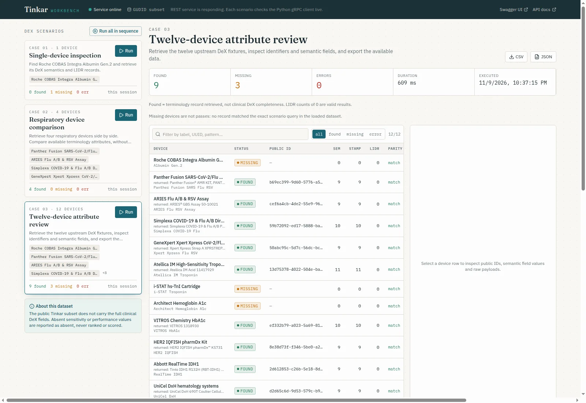
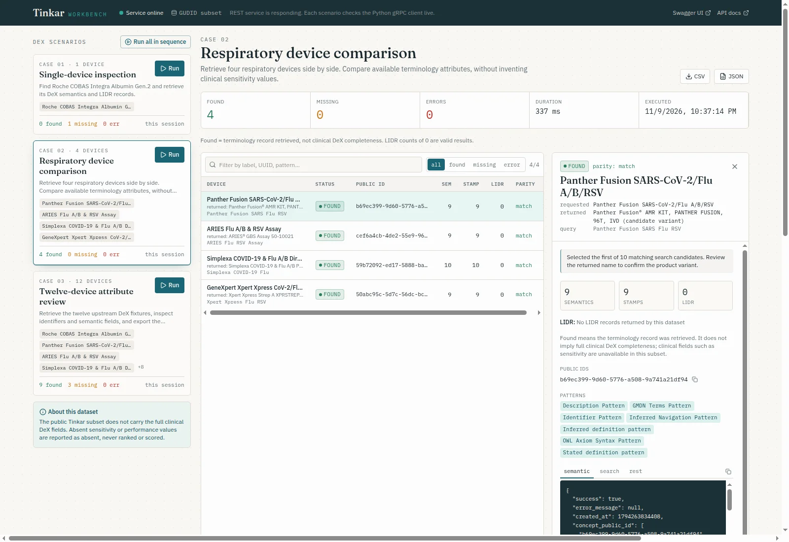

# Tinkar Workbench

A read-only web workbench for exploring medical-device terminology through Tinkar's REST API and a project-managed Python gRPC client.

The project demonstrates three upstream DeX scenarios against the public GUDID subset. It makes real device identifiers, semantic fields, STAMP metadata, transport comparisons, and dataset gaps visible in one interface.

> **Development demonstration, not a clinical decision-support tool.** A retrieved terminology record does not establish an exact product match, clinical performance, or complete DeX coverage. This repository is not yet a self-contained, one-command installation or a production deployment.

## Features

- Run each of the three scenarios individually, or run all three in sequence.
- Inspect requested fixture names alongside the actual returned product candidates.
- View public UUIDs, semantic patterns and field values, STAMP metadata, and LIDR availability.
- Compare search UUIDs and fully qualified names returned by REST and Python gRPC.
- Inspect the decoded Python search and semantic payloads alongside the REST search response.
- Filter device results and export the filtered table as CSV or the full scenario result as JSON.
- Retain previous results within the browser session, with restored results explicitly marked as previous runs.
- Access the service's Swagger UI and OpenAPI document.

The workbench does not save coordinates, import data, edit concepts, or run the reasoner. Its Python runner enforces a positive allowlist of read-only RPCs.

## UI Preview

These screenshots were captured from real, read-only scenario runs on **November 9, 2026**. They are static previews, not an interactive GitHub-hosted demo. Results depend on the loaded dataset and search queries.

### Twelve-device review

The review shows all twelve requested fixtures, with nine matching records retrieved and three requests without a matching candidate. Each row exposes identifier availability, semantic and STAMP counts, and REST/gRPC search parity.



### Device inspection

Selecting a row opens its returned candidate name, public UUIDs, semantic patterns, and decoded payloads. The requested fixture and returned name are shown separately: the candidate pictured below is an AMR kit returned by the Panther Fusion search, **not a verified match for the requested respiratory assay**.



### Contributor walkthrough

With the services running as described in [Getting started](#getting-started):

1. Open the root workbench preview and check the service availability indicator.
2. Select **Run all in sequence**, or use **Run** on an individual case.
3. Review **Found**, **Missing**, and **Errors**. Found means a terminology record was retrieved—not that clinical DeX data is complete.
4. Filter by device label, UUID, or pattern, or select the **found**, **missing**, or **error** filter.
5. Select a device row to compare the requested and returned names, inspect identifiers and patterns, and switch between the **semantic**, **search**, and **rest** payload tabs.
6. Use **CSV** to download the currently filtered table, or **JSON** for the full selected case result. Follow **Swagger UI** or **API docs** to explore the underlying service.

The workbench source is in [`artifacts/tinkar-workbench/`](artifacts/tinkar-workbench/). Screenshots are stored in [`docs/images/`](docs/images/) so GitHub can display them directly from the repository, without depending on a running development workspace.

## The three scenarios

| Case | Purpose | Requested devices |
| --- | --- | --- |
| 1 — Single-device inspection | Find Roche COBAS Integra Albumin Gen.2 and retrieve available semantics and LIDR records. | 1 |
| 2 — Respiratory device comparison | Review available terminology attributes for Panther Fusion, ARIES, Simplexa, and Xpert devices side by side. | 4 |
| 3 — Twelve-device attribute review | Retrieve the upstream device fixtures, inspect their available attributes, and export the results. | 12 |

The fixture definitions are in [`scripts/tinkar-scenarios.json`](scripts/tinkar-scenarios.json). Search queries and candidate-selection rules are in [`scripts/tinkar_workbench.py`](scripts/tinkar_workbench.py).

### Observed demonstration results

The last recorded live workbench verification on **November 9, 2026** returned:

| Case | Matching records retrieved | No matching candidate | Retrieval errors |
| --- | --- | --- | --- |
| Single-device inspection | 0 | 1 | 0 |
| Respiratory device comparison | 4 | 0 | 0 |
| Twelve-device attribute review | 9 | 3 | 0 |

These are observations from one dataset and the configured queries, not guaranteed results or a full-suite pass rate. “No matching candidate” does not prove that a product is absent from every dataset. The runner selects the first name-matching candidate among up to ten search results; inspect the returned name to confirm the product variant.

For that verification, REST and Python gRPC returned matching search identifiers and names. This comparison does **not** establish full semantic equivalence between transports.

## Architecture

```text
Browser — React workbench
    |
    | /api/workbench/*
    v
Express API — validates requests and queues scenario runs
    |
    v
Read-only Python runner — project-managed gRPC client
    |                                  |
    | gRPC                             | REST search comparison
    v                                  v
Tinkar Java service — public GUDID subset
```

| Component | Technology | Location |
| --- | --- | --- |
| Workbench | React, TypeScript, Vite, TanStack Query | `artifacts/tinkar-workbench/` |
| Workbench API | Express, TypeScript, generated Zod validation | `artifacts/api-server/` |
| API contract and clients | OpenAPI, Orval | `lib/api-spec/`, `lib/api-client-react/`, `lib/api-zod/` |
| Scenario runner and checks | Python, gRPC, pytest | `scripts/` |
| Compatible Python client | Vendored upstream client with local compatibility changes | `vendor/ikm-python/` |
| Active Java service and dataset | Tinkar, Java 27, public GUDID subset | Ignored `.local/` development directories |

The workbench uses the existing Tinkar data store; it does not migrate terminology data into another database.

## Getting started

### Requirements

- Node.js 24 and pnpm.
- Python 3.13 or newer and `uv`.
- A full **Java 27 JDK** for the service revision tested here. The verified workspace used an early-access Eclipse Temurin build.
- Git and access to the upstream Maven repositories and public dataset.
- Sufficient memory and disk space for the service, dependencies, and dataset. The startup script allows a **3 GiB Java heap**, in addition to other process overhead.

Verify the actual JDK using `java -version`; a toolchain's package name alone is not sufficient.

### 1. Install workspace dependencies

From the repository root:

```bash
pnpm install --frozen-lockfile
UV_PROJECT_ENVIRONMENT=.pythonlibs uv sync --locked
```

The Python environment installs the tracked client from `vendor/ikm-python`, rather than an unmodified upstream checkout.

### 2. Restore the Java service prerequisites

**A fresh Git clone does not include the running Java service, JDK, Maven cache, or dataset.** These are deliberately excluded from version control.

The current startup script expects:

```text
.local/
├── toolchains/jdk27/                 # Full Java 27 JDK
├── upstream/tinkar-service-current/  # Compatible upstream source and built JAR
├── m2-tinkar-current/                # Isolated Maven dependency cache
└── tinkar-data/                      # Downloaded dataset and writable store
```

The verified service source revision is:

```text
icaglobal/tinkar-service
3f9e6a8
```

The corresponding dependency set used service `1.0.5-SNAPSHOT`, core `1.127.7-SNAPSHOT`, and schema `1.43.5-SNAPSHOT`. Treat these as a coordinated set; changing one dependency independently may break compilation or client compatibility. Published SNAPSHOT contents can change, so the version labels alone do not guarantee a reproducible build.

After restoring the compatible source and JDK to the expected locations, build from the repository root:

```bash
ROOT="$PWD"
export JAVA_HOME="$ROOT/.local/toolchains/jdk27"
export PATH="$JAVA_HOME/bin:$PATH"

(
  cd "$ROOT/.local/upstream/tinkar-service-current"
  ./mvnw -ntp \
    -Dmaven.repo.local="$ROOT/.local/m2-tinkar-current" \
    -Dmaven.test.skip=true \
    -Dmaven.javadoc.skip=true \
    package
)
```

This command packages the service without running the Java tests. If your repository access requires a supplied Maven settings file, configure it separately through Maven's normal settings mechanism. Do not commit credentials or private settings.

See [`TINKAR-SETUP.md`](TINKAR-SETUP.md) for the existing workspace's setup details. Fully automated fresh-workspace bootstrap remains outstanding.

### 3. Start the services in Replit

Start the configured workflows:

1. **`artifacts/api-server: Tinkar`**
2. **`artifacts/api-server: API Server`**
3. **`artifacts/tinkar-workbench: web`**

The Tinkar workflow runs `scripts/run-tinkar.sh`, which selects `gudidsubset` and allows the service to provision the public dataset on startup. Initial download and indexing can take several minutes.

Open the root preview once startup completes. The workbench reports service availability and provides **Run** and **Run all in sequence** controls.

The configured reverse proxy is part of this setup. Running only the Vite frontend outside Replit is not sufficient: a local deployment must also reproduce the routes below, supply the service environment, and connect the Python runner to Tinkar.

### Service routes

| Route or listener | Purpose |
| --- | --- |
| `/` | Workbench |
| `/api/workbench/status` | REST service availability |
| `/api/workbench/scenarios` | Scenario definitions |
| `POST /api/workbench/scenarios/{id}/run` | Execute read-only case `1`, `2`, or `3` |
| `/tinkar/swagger-ui/index.html` | Tinkar Swagger UI |
| `/tinkar/api-docs` | Tinkar OpenAPI document |
| `/tinkar/api` | Tinkar REST base path |
| Internal port `9000` | Tinkar gRPC listener |

The Java REST service uses internal port `8099`; the Express API uses `8080`. The workbench API and Python REST comparison expect the shared proxy on port `80`. External gRPC access is not configured or verified.

## Verification

### Type checks

```bash
pnpm run typecheck
```

### Python regression tests

```bash
.pythonlibs/bin/python -m pytest scripts/tests -q
```

### Live read-only compatibility check

With Tinkar running:

```bash
bash scripts/check-tinkar.sh
```

The checker validates current wire schemas, real identifiers, STAMP metadata, and representative REST/gRPC results. A compatibility failure produces a nonzero exit code.

### Broader upstream scenario suites

Upstream scenarios can include writes, including tests not marked destructive. **Do not run the complete suites against the active workbench store.**

The disposable-store runner is:

```bash
bash scripts/check-tinkar-disposable.sh
```

It requires additional upstream checkouts and tools, including `grpcurl`, plus a second service instance. It extracts a separate dataset, uses ports `8100` and `9001`, and stores diagnostic output under ignored directories. Some upstream scenarios have known failures or missing fixtures; this is not an all-green acceptance command.

See [`TINKAR-VERIFICATION.md`](TINKAR-VERIFICATION.md) for detailed results, historical compatibility failures, prerequisites, and safety notes.

## Python client compatibility work

The project-managed client addresses mismatches observed between the original Python client and the active Java service:

- Decode packed `PublicId.uuid_bits` without silently losing record UUIDs.
- Preserve multiple identifiers, timestamps, STAMP identifiers, and named semantic fields.
- Use the current PublicId message format for coordinate fields and saved-coordinate references.
- Route supported legacy calls to the current GraphRAG and KnowledgeGraph services.
- Align the declared gRPC runtime requirement with the generated stubs.
- Fail explicitly for obsolete unary admin operations that now require streaming-job handling.

These are **local compatibility changes**, not a claim that upstream repositories have incorporated them or that all API operations are supported.

Client provenance and schema details: [`vendor/ikm-python/PROVENANCE.md`](vendor/ikm-python/PROVENANCE.md).

To regenerate the committed client stubs after deliberately updating the vendored schemas:

```bash
.pythonlibs/bin/python scripts/generate-tinkar-client.py
```

After changing the workbench's OpenAPI contract:

```bash
pnpm --filter @workspace/api-spec run codegen
```

## Limitations and safety

- **Incomplete clinical data:** the public subset does not provide complete sensitivity, limit-of-detection, reference-range, specimen-type, or units data for these scenarios. The workbench does not infer missing values or rank clinical performance.
- **Search candidate ambiguity:** a name match is not a verified exact device identifier match.
- **Concurrency:** concurrent searches produced inconsistent results during development. Workbench scenario runs are queued and device searches are serialized as a mitigation. The upstream cause has not been established; other tools can still issue competing searches.
- **Source-level omissions:** optional pattern UUIDs omitted by the service remain unavailable in the client; labels are not used to manufacture identifiers.
- **Development-only startup:** required service binaries and runtime data are not included in the repository.
- **Not production-hardened:** this demonstration adds no authentication or authorization layer. Do not expose it or the underlying service publicly with sensitive data without appropriate access controls, TLS, resource limits, and deployment review.
- **Exports:** CSV and JSON files are generated in the browser. They contain retrieved terminology data, not a validated clinical DeX report.

## Upstream projects and attribution

- [Tinkar service](https://github.com/icaglobal/tinkar-service) — Java REST and gRPC service.
- [IKM Python client](https://github.com/icaglobal/ikm-python) — upstream source for the vendored Python client.

This repository adds the workbench, integration layer, verification tooling, and project-managed client compatibility changes. The earlier checkout under `tinkar-service/` is retained for reference; it is **not** the source used by the current startup script.

Third-party code and datasets retain their respective terms. Consult upstream notices and the vendored client's provenance before redistributing them; this README does not assign a new license to upstream material.
